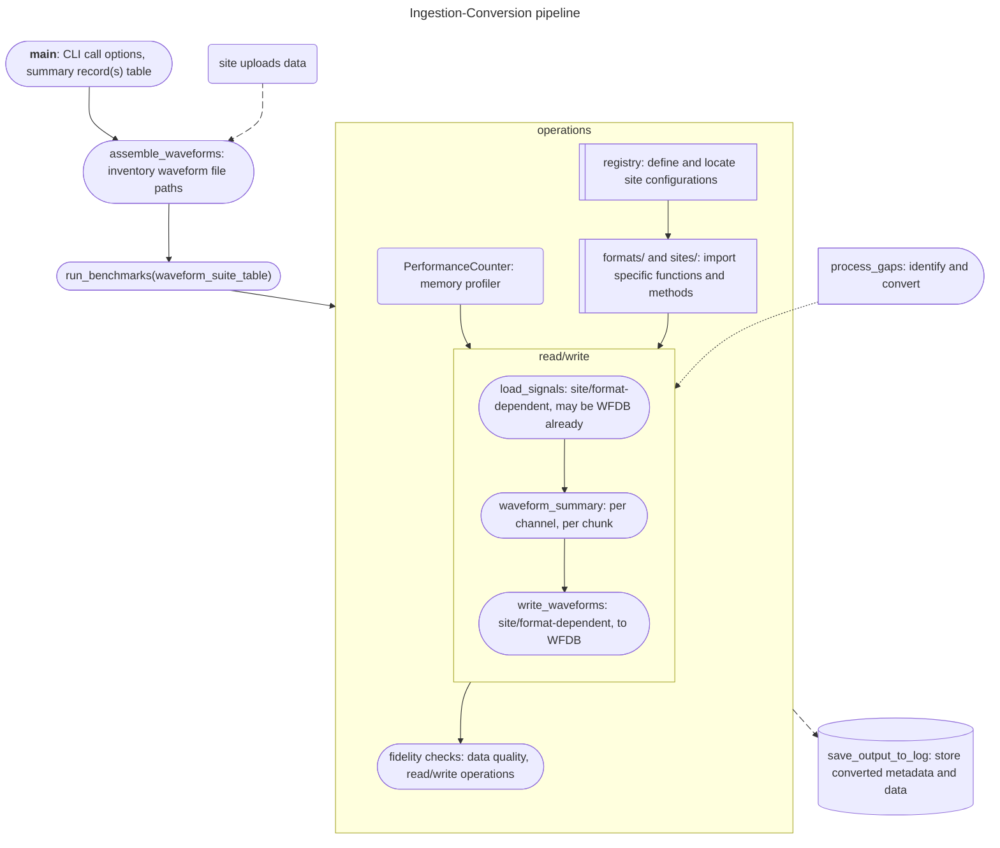

### Intro
Project architecture to centrally ingest CHoRUS site waveforms; identify and correct gaps; and convert to WFDB format.

Layout mimics extensive work done [here](https://github.com/chorus-ai/chorus_waveform/tree/main) by some wonderful people.

Below diagrams how waveform data flows with this framework, starting at site upload.



### Repo layout
```
central_wfs/
├── config/ # setup
│ ├── .env
│ └── environment.yml # conda/mamba install
├── src/ # Source code
│   ├── qc/
│   │   ├── chs_norm.py # check channel mappings
│   │   ├── data.py # fidelity check on data quality
│   │   ├── gaps.py # identify and correct gaps
│   │   └── ioperf.py # monitor memory & performance
│   ├── formats/
│   │   ├── map.py # dictionary to standardize site file extensions
│   │   ├── csv.py
│   │   ├── parquet.py
│   │   ├── wfdb.py
│   │   ├── format_n.py
│   ├── sites/
│   │   ├── uf.py
│   │   ├── columbia.py
│   │   ├── mgh.py
│   │   ├── mit.py
│   │   └── site_n.py
│   ├── __main__.py # entry point
│   ├── __init__.py
│   ├── base.py # define site/format-specific class requirements
│   ├── registry.py # define site configs
│   └── utils.py
├── data/
│   └── suites/ # file path tables
├── tests/ # unit/integration tests
├── docs/ # documentation
├── .gitignore
├── pyproject.toml # pip install
├── requirements.txt # python dependencies
└── README.md # project overview
```

#### Design notes
1. Making gap tooling central versus site-specific (currently central).
2. Abstracting site AND format class methods in preparation for potential heterogeneity of site waveform uploads.
3. Additional modifications were denoted in the neighborhood with '###'
4. Site-specific classes inherit from format-specific classes, and include a method for assembling the waveform suite table.